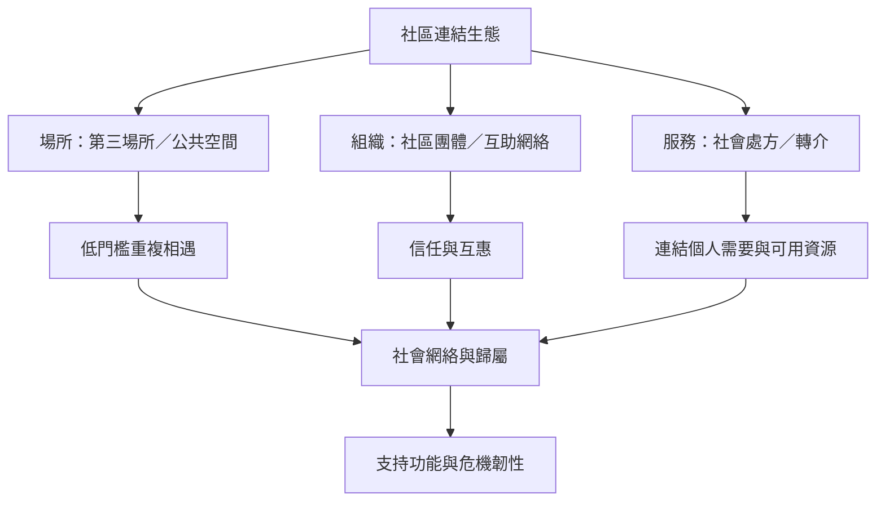

可持續的社區連結需要場所、組織、參與方式與支持轉介互相配合。第三場所提供相遇機會，社會基礎設施支撐日常互動，社會處方協助人們接上資源，而參與式介入則讓人共同創造關係。

單一活動不足以解決結構障礙。設計介入時要確認交通、費用、語言、無障礙、時間與文化安全，也要用縱向方式檢視關係是否延續。相關筆記包括[[社會基礎設施能支撐日常互動與危機互助]]、[[社會處方只有在社區資源可近時才有意義]]、[[有效介入應讓參與者成為關係的共同創造者]]及[[長期社會退縮需要安全且可逐步參與的入口]]。

## 參考
* 研究依據：[[高齡者社會孤立介入研究支持參與式團體方案但證據仍有異質性]]、[[英國社會處方研究呈現希望但因果證據仍不足]]、[[第三場所研究將日常聚會空間視為社區社會資本的來源]]。

本卡收錄於[[Social_isolation]]。
