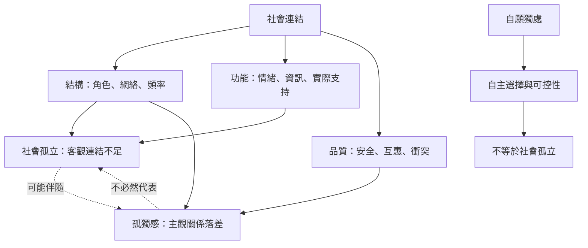

社會孤立、孤獨感與自願獨處都涉及人與他人的距離，但三者回答不同問題。客觀網絡與互動不足是社會孤立；實際與期望關係之間的主觀落差是孤獨感；自主選擇且保有關係出口的安靜時間則可能是自願獨處。分析時應再加入結構、功能與品質三個維度。

閱讀這張圖時，應把評估工具與介入對象分開：網絡量表不能替代孤獨量表；活動出席紀錄也不能替代關係品質訪談。相關討論見[[社會孤立是客觀連結不足而孤獨感是主觀落差]]、[[自願獨處與被迫孤立需要不同的判讀方式]]、[[社會連結必須同時衡量結構功能與品質]]及[[測量社會孤立必須兼顧文化脈絡與工具差異]]。

## 參考
* 主要依據：[[WHO全球社會連結報告將孤立視為公共衛生與社會政策議題]]。
* 測量案例：[[台灣社區篩檢研究顯示孤獨估計會隨量表而改變]]。

本卡收錄於[[Social_isolation]]。
