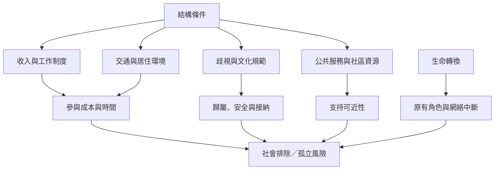

社會孤立的風險會隨生命轉換、社會位置與地方環境改變。搬遷、失業、退休、照顧責任、疾病、歧視、交通缺乏與公共空間衰退，都可能讓關係網絡失去日常維持的條件。

結構性分析能避免把孤立歸咎於個人缺乏積極性。日本蟄居案例、難民遷移回顧、台灣高齡研究與城市熱浪研究，分別呈現教育職場、強迫遷移、社區環境與公共空間如何影響連結。閱讀相關筆記：[[社會孤立不只是個人困境也可能由城市與制度共同生產]]、[[社會連結機會受到社區權力與安全條件分配]]、[[社會孤立常沿著生命轉換與負面經驗逐步累積]]。

## 參考
* 跨地區案例：[[日本蟄居者訪談顯示長期退縮往往由多次負面經驗累積而成]]、[[強迫遷移會削弱高齡難民的原有網絡而數位工具難以完全補足]]、[[印度大樣本老年研究指出偏遠地區的連結機會可能較少]]。

本卡收錄於[[Social_isolation]]。
