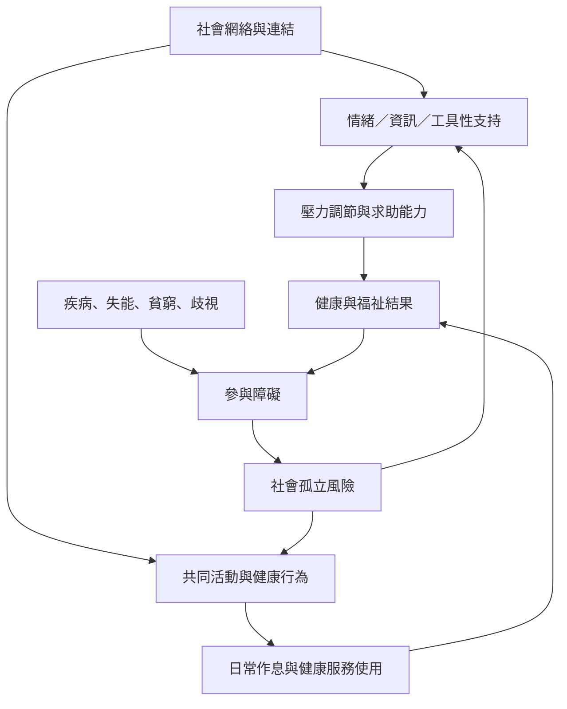

社會孤立與健康風險之間不是一條單向直線，而是由支持資源、資訊、生活行為、壓力與反向因果共同組成的循環。疾病與失能也可能削弱網絡，使孤立與健康困難互相強化。

大型統合分析顯示社會孤立、孤獨感與死亡風險相關，但研究設計仍需處理混雜與反向因果。閱讀重點應放在可能的機制與可介入條件，而不是把風險比轉成個人命運。可連結[[社會孤立與健康風險之間存在多條可能路徑]]、[[九十個世代研究顯示社會孤立與較高死亡風險相關]]及[[Berkman與Syme的阿拉米達研究把社會網絡帶入公共衛生研究]]。

## 參考
* 研究依據：[[148項研究的統合分析指出社會關係與存活率相關]]、[[美國國家科學院報告主張醫療系統應辨識老年人的孤立風險]]。

本卡收錄於[[Social_isolation]]。
