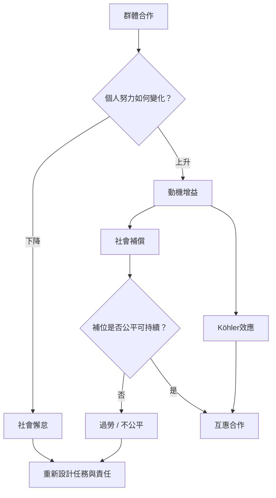

群體不只會稀釋努力，也可能創造動機增益。社會補償與 Köhler 效應呈現不同路徑；另一方面，互助社群若依賴少數成員長期補位，會使動機增益轉成不公平負擔。核心問題是：如何讓每個人都感到被需要，同時保留公平、彈性與可持續性。

主要概念：[[社會補償]]、[[Köhler效應]]、[[公平]]、[[群體凝聚力]]、[[搭便車問題]]。

重要永久筆記：[[團體合作不只會稀釋努力也可能創造動機增益]]、[[社會補償是成員為了維持團隊成果而增加自己的投入]]、[[Köhler效應讓能力較弱的成員在特定團隊任務中提高努力]]。

行動靈感：[[把團隊中的隱形勞動納入公平檢視]]、[[在互助社群中用互惠規範避免把照顧變成少數人的負擔]]、[[讓每位成員擁有互補且不可替代的角色]]。
