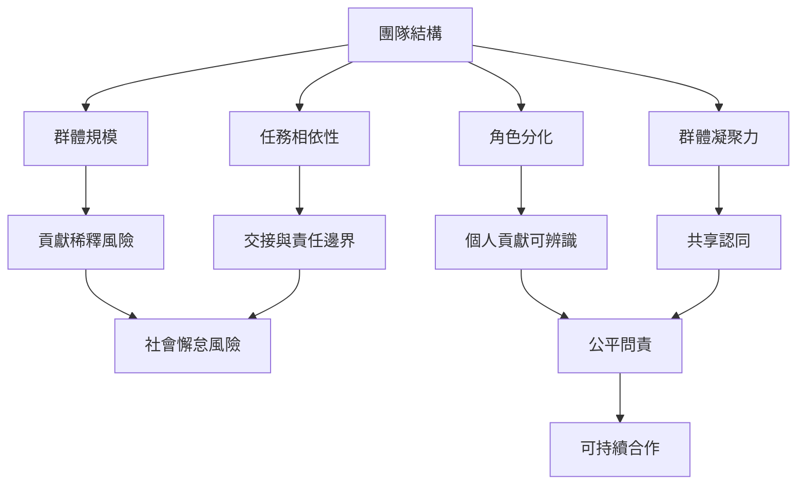

團隊的組織方式會改變努力是否可見、責任是否清楚、同伴是否可信，以及成員是否感到公平。團隊規模、任務相依性、凝聚力與評量制度不能單獨決定結果，必須一起考慮。此地圖聚焦制度設計與實際工作安排。

主要概念：[[任務相依性]]、[[群體凝聚力]]、[[角色分化]]、[[問責]]、[[公平]]、[[可辨識性]]。

重要永久筆記：[[群體人數增加會提高貢獻稀釋的風險但不是唯一原因]]、[[工作相依性若沒有清楚責任界線會讓個人努力難以辨識]]、[[群體認同能提升投入但不能取代個人責任]]、[[公平感受會影響成員是否願意持續投入]]。

實務研究：[[職場田野研究發現團體規模與凝聚力會影響社會懈怠]]、[[四十三國全球虛擬團隊研究支持公平監測可降低搭便車]]。
