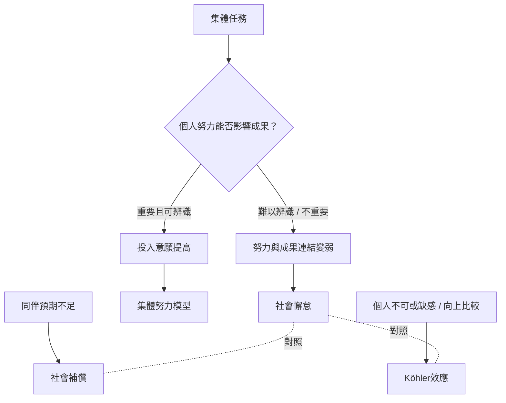

社會懈怠可以理解為個人努力與集體成果之間的連結變弱。核心問題包括：個人貢獻能否被辨識、投入能否改變成果、成果是否有價值，以及成員是否認同團隊。這張地圖把定義、機制與反向動機增益放在同一脈絡。

主要概念：[[社會懈怠]]、[[集體努力模型]]、[[可辨識性]]、[[動機損失]]、[[社會補償]]、[[Köhler效應]]、[[任務意義]]、[[社會認同]]。

重要永久筆記：[[社會懈怠是集體任務中個人努力相對下降的現象]]、[[個人貢獻不可辨識會削弱努力的可評價性]]、[[集體努力模型說明人們何時願意把個人努力投入集體成果]]、[[團體合作不只會稀釋努力也可能創造動機增益]]。

研究入口：[[七十八項研究的統合分析指出社會懈怠會受到多種條件調節]]、[[Köhler效應研究指出不可或缺感與向上比較可能提高團體動機]]。
