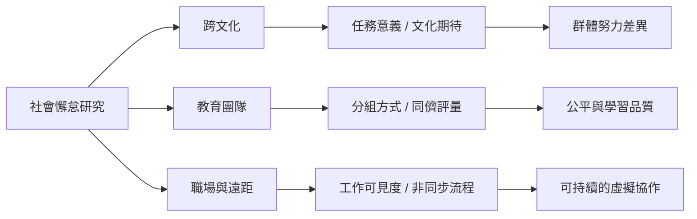

社會懈怠不是只存在於實驗室。教育、跨文化組織與遠距團隊都會遇到個人貢獻辨識、合作規範、任務意義與公平評量問題。跨文化研究尤其提醒：文化不能化約為固定國民性，任務如何被理解同樣重要。

主要概念：[[社會懈怠]]、[[任務意義]]、[[公平]]、[[可辨識性]]、[[社會認同]]。

研究入口：[[台灣學童研究發現簡單發聲任務中的社會懈怠與美國研究相近]]、[[台灣與美國的認知追蹤任務呈現不同的群體努力模式]]、[[中國大學生混合方法研究將能力情感關係與集體認同列為前因]]、[[線上心理學學生訪談指出非同步協作需要更清楚的貢獻評估]]。

實務延伸：[[遠距團隊需要把合作流程設計成可見而非把成員變成監控對象]]、[[讓跨文化團隊先談合作期待再談文化差異]]。
