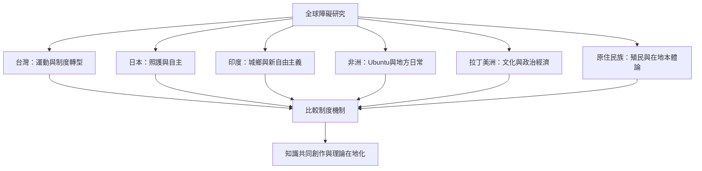

本圖將跨地區研究當作理論互相修正的過程，而非國家排名。台灣、日本、印度、非洲、拉丁美洲與原住民族研究呈現不同的運動路徑、照護制度、殖民歷史與資源條件。

延伸閱讀：[[台灣障礙者運動推動政策由慈善邏輯轉向社會模式]]、[[日本自立生活運動指出照護支持是自主的前提]]、[[印度農村案例揭露個人賦權方案可能遮蔽結構性障礙]]、[[Ubuntu視角把障礙放回共同人性與關係性責任]]、[[烏干達案例顯示法律進步不會自動轉化為日常平等]]、[[拉丁美洲障礙研究把身體差異連結人權與反資本主義批判]]、[[原住民族障礙觀點要求把殖民歷史與在地本體論納入分析]]、[[在地知識必須參與障礙定義而非只被國際分類測量]]、[[建立跨地區比較時先比較制度機制而不是排名國家]]

[[Social_model_of_disability]]
