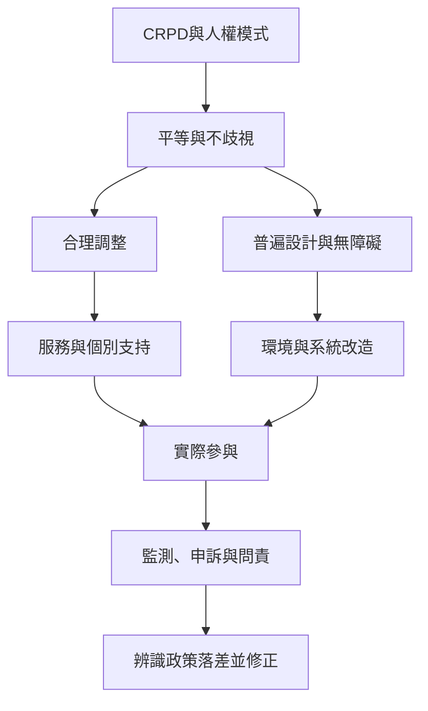

本圖把國際人權規範連到日常制度：公約提供權利義務，合理調整和普遍設計提供實作方式，而政策落差分析檢查權利是否真正可用。

延伸閱讀：[[身心障礙者權利公約以障礙與環境互動理解參與限制]]、[[人權模式在社會模式基礎上補足國家責任與救濟]]、[[合理調整是平等參與的具體制度工具]]、[[無障礙必須涵蓋數位能源交通與災害應變系統]]、[[政策成文不等於障礙者實際獲得權利]]、[[用權利落差地圖追蹤法律如何落到日常生活]]、[[CRPD]]、[[合理調整]]、[[普遍設計]]、[[無障礙]]

[[Social_model_of_disability]]
