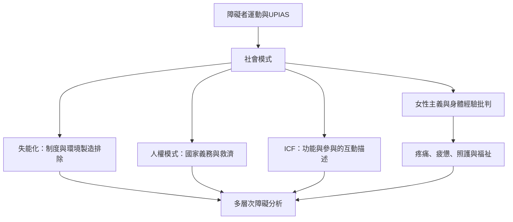

本圖從障礙者運動的政治主張出發，連接社會模式、醫療模式、人權模式與ICF，並保留身體經驗和哲學批判作為必要修正。核心問題不是哪一模型獨占真理，而是每個模型讓我們看見哪些機制、責任與可能的行動。

延伸閱讀：[[英國障礙者運動將障礙重新定義為社會壓迫]]、[[Michael Oliver將社會模式發展為失能化的社會分析]]、[[障礙是社會製造的排除而非個人的缺陷]]、[[社會模式是政治分析工具而不是排他的因果理論]]、[[承認身體痛苦不等於接受社會排除]]、[[醫療支持與社會除障可以同時成立]]、[[社會模式]]、[[醫療模式]]、[[人權模式]]、[[ICF]]

[[Social_model_of_disability]]
