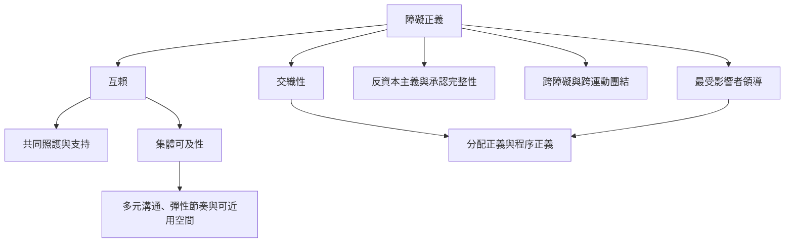

此圖呈現障礙正義如何把社會模式擴展到交織性與分配正義，並以互賴、照護與集體可及性把抽象理念轉成日常實踐。

延伸閱讀：[[障礙正義以交織性互賴與集體可及性擴展社會模式]]、[[交織性分析能揭露單一障礙身分遮蔽的差異]]、[[互賴可以成為障礙正義的政治原則]]、[[集體可及性將參與責任分散到整個社群]]、[[照護與自主必須被理解為互相支持的關係]]、[[障礙正義]]、[[交織性]]、[[互賴]]、[[集體可及性]]

[[Social_model_of_disability]]
