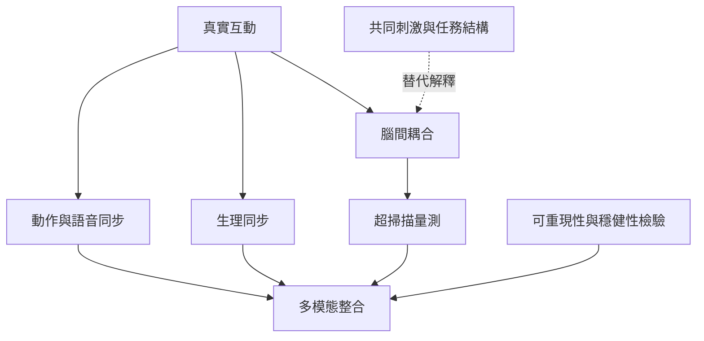

這張地圖聚焦人際同步、超掃描與真實互動研究。不同訊號的同步需分開定義，並排除共同刺激及分析方法等替代解釋。同步資料應與行為、主觀感受和任務脈絡共同解讀。

## 概念關係圖

## 概念連結
* [[人際同步]]
* [[超掃描]]
* [[研究可重現性]]
* [[人際同步是多模態關係現象而非親密程度量尺]]
* [[超掃描能研究互動但不能單憑同步推論心理連結]]
* [[社會互動是可以被感知與表徵的關係事件]]

回到導讀：[[Social_neuroscience]]
