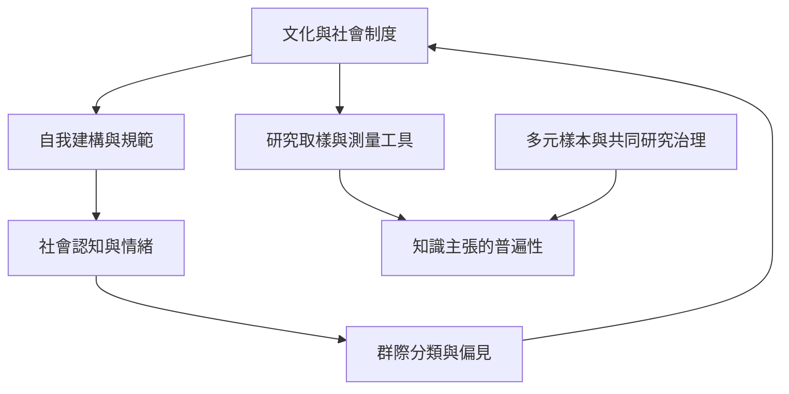

這張地圖提醒讀者，社會認知與腦功能的研究從來不是脫離文化的普遍測量。文化神經科學需要多元樣本，也需要檢視測量工具、研究治理和知識權力。內群體偏見並非固定本能，應放在歷史、制度與互動情境中分析。

## 概念關係圖

## 概念連結
* [[文化神經科學]]
* [[自我建構]]
* [[群際偏見]]
* [[社會神經科學需要全球多元樣本與文化有效的方法]]
* [[跨文化研究的樣本代表性限制人類心理結論的普遍性]]
* [[知識正義]]

回到導讀：[[Social_neuroscience]]
