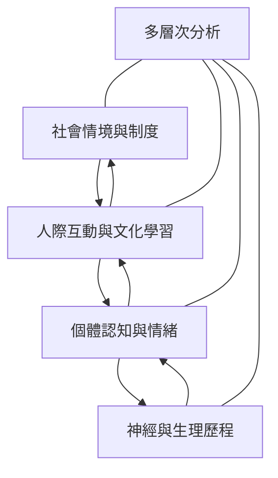

這張地圖整理社會神經科學的學科核心：以神經與身體機制研究社會行為，同時承認社會環境會反過來形塑生物歷程。閱讀時應由多層次分析出發，避免將複雜社會現象縮減成單一腦區。

## 概念關係圖

## 概念連結
* [[社會神經科學]]
* [[多層次分析]]
* [[社會行為需要跨層次解釋而非還原成腦區]]
* [[文化神經科學]]
* [[自我建構]]
* [[社會認知]]

回到導讀：[[Social_neuroscience]]
