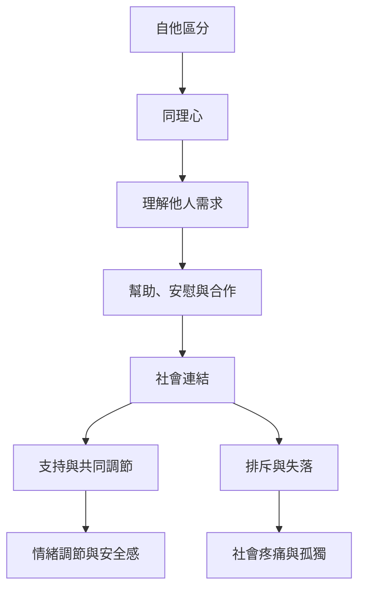

這張地圖把同理、社會疼痛、孤獨、社會支持與親社會行為放在關係脈絡中理解。社會連結可以成為調節資源，也可能因排斥、失落或支持不足而成為壓力來源；同理不等於替他人決定。

## 概念關係圖

## 概念連結
* [[同理心]]
* [[心智化]]
* [[社會基線理論]]
* [[孤獨]]
* [[社會疼痛]]
* [[社會支持]]
* [[親社會行為]]
* [[合作是連續調節的互動歷程而非單一親社會本能]]

回到導讀：[[Social_neuroscience]]
