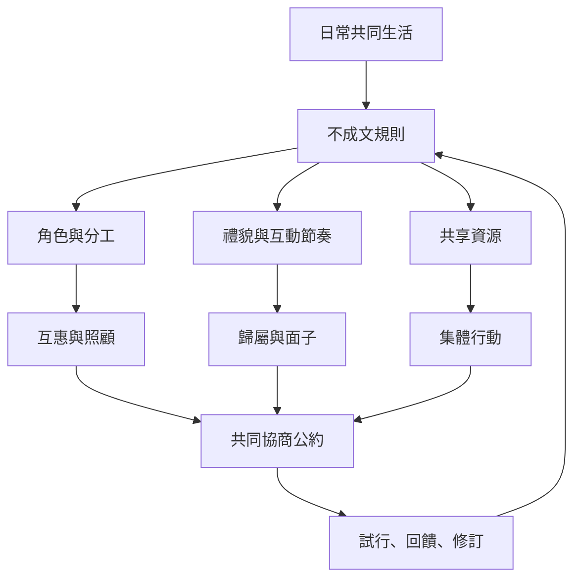

這張地圖將社會規範拉回日常生活：共餐、讀書會、社區合作、公共空間與線上社群。規範既讓互動可預期，也可能讓新加入者承受看不見的門檻。好的共同規則應能被理解、被質疑、共同維護與定期修訂。

概念入口：[[term/社會規範]]、[[term/參照群體]]、[[term/社會制裁]]、[[term/社會化]]、[[term/集體行動]]、[[term/社會網絡]]。

行動筆記：[[idea/從日常空間的細節辨認隱性規範]]、[[idea/用匿名預測校準群體對彼此期待的想像]]、[[idea/讓社群公約成為可退出可修訂的共同作品]]、[[idea/以共同實作培養新規範而非只宣導理念]]、[[idea/區分照顧性的互助規則與壓迫性的服從要求]]。

書庫導讀：[[Social_norm]]。
