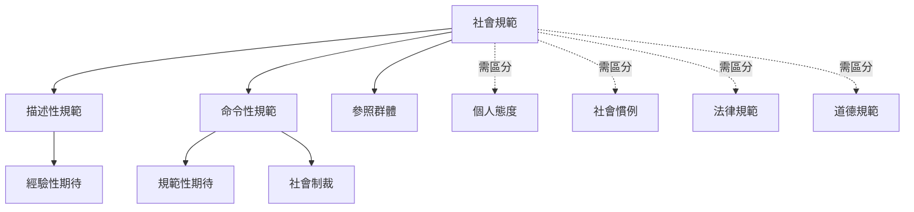

這張概念地圖處理「什麼是社會規範」以及如何區分描述性規範、命令性規範、個人態度、慣例與法律。閱讀時應先定義行為情境與參照群體，再辨認人們依據什麼期待採取行動。

核心概念：[[term/社會規範]]、[[term/描述性規範]]、[[term/命令性規範]]、[[term/經驗性期待]]、[[term/規範性期待]]、[[term/參照群體]]、[[term/社會制裁]]、[[term/個人態度]]、[[term/社會慣例]]、[[term/法律規範]]、[[term/道德規範]]。

延伸閱讀：[[note/社會規範是群體情境中依共享期待自我維持的非正式規則]]、[[note/描述性規範與命令性規範回答不同問題]]、[[note/個人態度不能替代對群體規範的測量]]。

書庫導讀：[[Social_norm]]。
