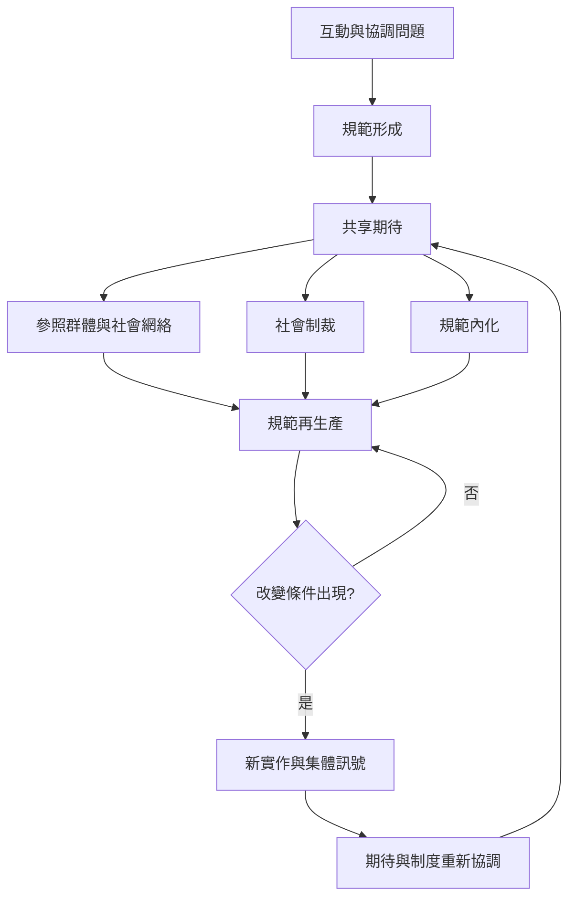

這張地圖從規範的生命歷程出發，整理形成、再生產與改變的機制。規範可能透過協調、互惠、社會化與權力關係形成，藉由期待、制裁、內化與網絡互動維持，也可能因新訊號、集體行動與制度變動而轉型。

核心概念：[[term/社會規範]]、[[term/規範改變]]、[[term/規範企業家]]、[[term/規範內化]]、[[term/集體行動]]、[[term/社會網絡]]、[[term/非正式制度]]。

延伸閱讀：[[note/規範形成需要分辨起源維持與改變機制]]、[[note/規範擴散不是單純的病毒式傳播]]、[[note/規範改變需要可信的集體訊號而非單一英雄]]、[[note/規範改變需要集體協調與可行替代選項]]。

書庫導讀：[[Social_norm]]。
