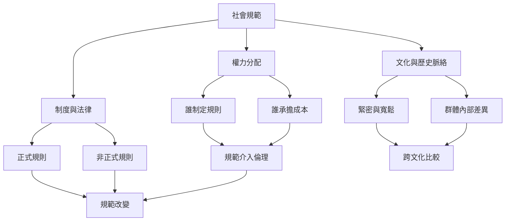

規範從來不是純粹的心理現象。誰能制定規則、誰必須遵守、誰能豁免，以及誰承擔違規後果，都涉及權力與不平等。跨文化研究則需要避免國家本質化，將比較落在具體行為、參照群體與制度情境。

核心概念：[[term/權力]]、[[term/文化緊密度與寬鬆度]]、[[term/法律規範]]、[[term/非正式制度]]、[[term/社會控制]]、[[term/社會制裁]]。

延伸閱讀：[[note/規範同時維持社會秩序也可能再製不平等]]、[[note/文化差異不能被國家平均值取代]]、[[note/規範介入必須看見權力與風險分配]]、[[note/法律規則與非正式規範會彼此塑造]]。

案例入口：印度種姓互動、衣索比亞與孟加拉性別規範、全球反女性割禮社群工作，以及不同文化場域的規範強度比較。

書庫導讀：[[Social_norm]]。
