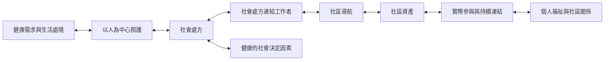

本圖整理社會處方由健康需求辨識、關係式導航、共同選擇到持續參與的基本路徑。連結工作者是重要角色，但實際效果仍取決於社區資產和跨部門條件。

* [[社會處方]]
* [[社會處方連結工作者]]
* [[社區導航]]
* [[以人為中心照護]]
* [[社區資產]]
* [[社會處方把健康照護從診間延伸到社區關係]]
* [[社會處方的核心不是活動清單而是有關係的導航]]
* [[連結工作者需要陪伴而不只是行政轉介]]
