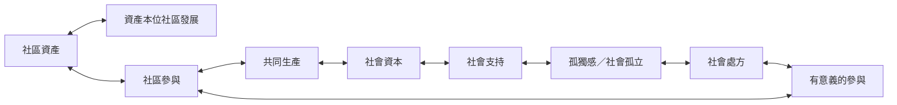

本圖把社會處方視為一種讓居民進入社區生活、建立支持關係並共同創造公共價值的過程。活動本身不是目的，關係、歸屬和參與者的自主角色同樣重要。

* [[社區資產]]
* [[資產本位社區發展]]
* [[社區參與]]
* [[共同生產]]
* [[社會資本]]
* [[社會支持]]
* [[孤獨感]]
* [[社會孤立]]
* [[人際連結與有意義的參與可能是社會處方的重要機制]]
* [[參與社群的價值不應完全被醫療化]]
