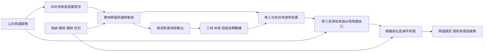

全球照護鏈將移民、家庭、勞動市場與原居地社群連結起來。本圖呈現照護責任如何跨國移動，以及性別、階級、種姓、種族與國籍如何影響勞動者的選擇與保障。實際鏈條會因移民制度、家庭型態與目的地政策而不同，不應把所有移工經驗套進單一模型。

## 思與行
* 分析移民照護政策時，將目的地與原居地家庭同時放入視野。
* 記錄移工自身的照護權、休息權與家庭團聚權，而不只分析目的地的勞動力供給。
* 參照 [[全球照護鏈把照護責任跨國重新分配]]、[[照護赤字往往被轉嫁給權力較弱的人]] 與 [[再生產勞動的價值與地位受階級種姓性別共同塑造]]。

## 參考
* 區域研究：[[東亞照護移民制度比較顯示文化相近不代表照護政策相同]]、[[菲律賓跨國家庭研究呈現移民勞動與親職照護的雙重代價]]。
