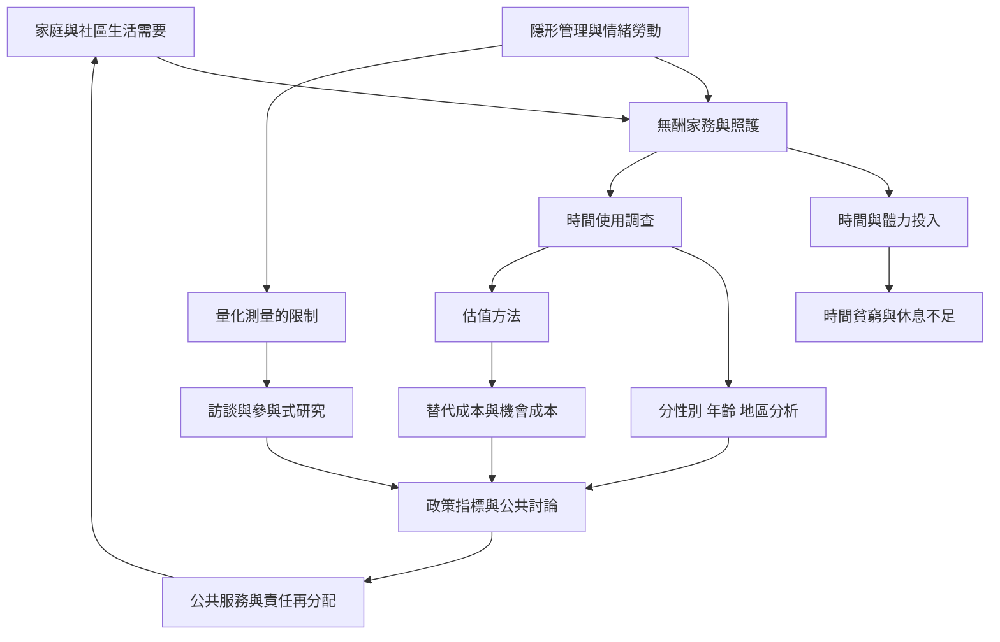

此圖整理無酬勞動如何造成時間貧窮，以及時間使用調查、估值與政策指標能夠揭露什麼、又無法揭露什麼。測量是政策討論的起點，不應取代對權力、關係與照護品質的質性理解。

## 思與行
* 同時使用時間使用數據與生活故事，避免單一數字掩蓋同時進行的照護與情緒工作。
* 測量後追問責任如何重新分配，而不只計算照護者的產值。
* 連結 [[時間使用調查能讓隱形勞動進入公共討論]]、[[無酬勞動的經濟價值不能只用市場價格衡量]] 與 [[照護危機是制度矛盾而非個人時間管理失敗]]。

## 參考
* 主要資料：[[聯合國永續發展目標資料持續顯示女性承擔較多無酬家務與照護]]、[[國際勞工組織指出無酬照護是全球勞動與性別不平等的核心]]。
