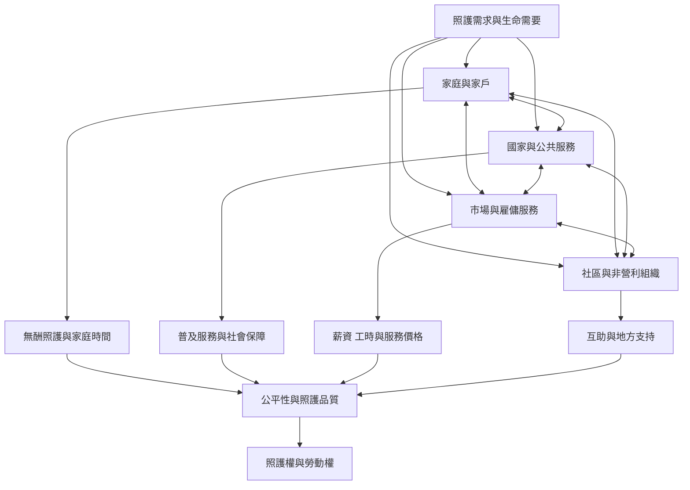

此圖以照護鑽石整理照護服務的供給與責任分配，並連結服務可及、工作條件、家庭負擔與社會權利。四個部門不是彼此獨立：公共政策會塑造市場，市場會改變家庭分工，社區可能補足缺口，也可能被制度過度依賴。

## 思與行
* 用照護鑽石分析長照、托育或身心障礙支持服務，標示資金、勞動與決策權流向。
* 以 [[照護制度由家庭國家市場與社群共同構成]]、[[照護工作者需要勞動權而不只是道德感謝]] 與 [[社區照護不能成為政府卸責的免費替代品]] 作為閱讀路徑。

## 參考
* 主要依據：[[莎赫拉・拉扎維提出照護鑽石以分析家庭國家市場與社群]]、[[烏拉圭以法律建立國家整合照護體系並定義共同責任]]。
