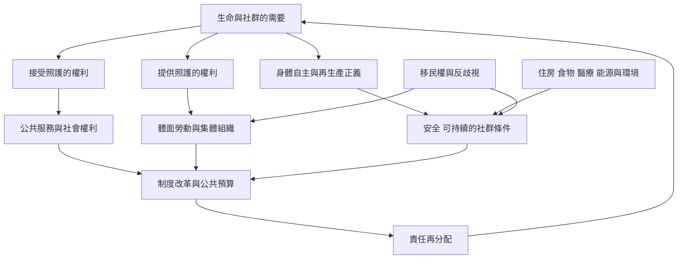

此圖將再生產正義、照護權、勞動權與集體行動放在同一張圖中。社會再生產不是單純保護家庭原狀；它可以成為重組公共責任、身體自主、社群安全與勞動關係的政治場域。

## 思與行
* 以接受照護者、提供照護者與社區居民三種視角檢查政策。
* 把身體自主與安全社群條件納入照護政策，而不是將再生產正義縮減成生育醫療選擇。
* 連結 [[再生產正義要求人們能在安全社群中養育子女]]、[[照護可以被制度化為公共責任與社會權利]] 與 [[社會再生產的政治包含邊界鬥爭]]。

## 參考
* 主要依據：[[再生產正義由黑人女性主義提出並連結生育與安全社群條件]]、[[拉丁美洲照護論述正從勞動權延伸到照護權與多元知識]]。
