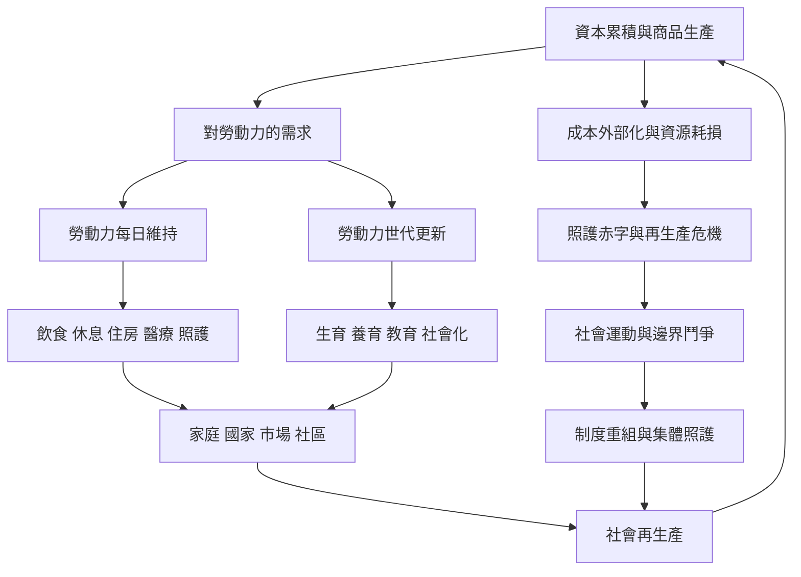

本圖整理社會再生產的基本理論關係：資本主義生產需要勞動力與社會秩序持續更新；每日維持與世代延續仰賴有薪／無酬勞動、家庭、國家、市場、社區及生態條件。這些條件同時可能再製階級、性別與種族化分層，也可能成為集體組織與制度改造的起點。

## 思與行
* 將特定產業或政策放入此圖，標記它依賴哪些再生產條件、把成本轉移給誰。
* 對照 [[資本累積依賴再生產卻會侵蝕再生產條件]] 與 [[社會再生產的政治包含邊界鬥爭]]，理解危機與轉型之間的關係。

## 參考
* 核心筆記：[[社會再生產是維持生命與更新社會關係的整體過程]]、[[勞動力的每日維持是資本主義生產的前提]]、[[照護危機是制度矛盾而非個人時間管理失敗]]。
