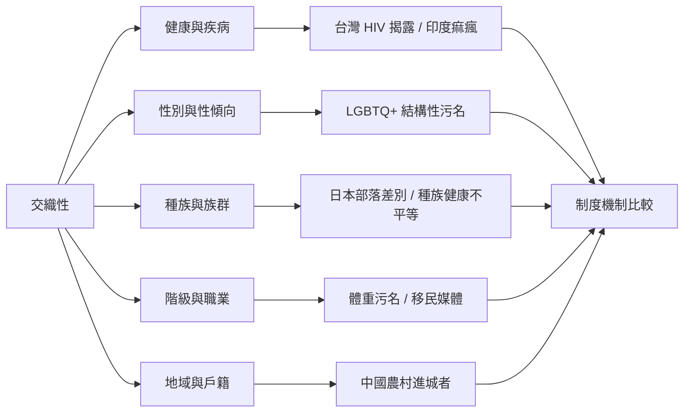

跨地區比較不應把污名歸結為單一文化特質，而要比較分類、制度與歷史機制。交織性使研究者能理解同一人同時處於不同權力關係之中。

概念連結：[[交織性]]、[[台灣 HIV 身分揭露經驗呈現隱匿壓力與制度差別待遇]]、[[印度痲瘋污名同時受到歷史文化與醫療知識落差影響]]、[[中國農村進城者的污名與戶籍制度和城市階序相互嵌合]]、[[日本部落差別顯示歷史職業污名可以轉化為居住地歧視]]、[[LGBTQ+ 結構性污名與健康風險存在跨研究的一致關聯]]、[[體重污名深植於把體型歸咎於個人責任的政策敘事]]。

巴西案例補充：[[巴西漢生病患者訪談顯示污名透過工作家庭與沉默延續]]、[[巴西門診研究指出醫療互動本身也可能產生醫源性污名]]。本圖屬於[[Social_stigma]]的閱讀與整理架構。
