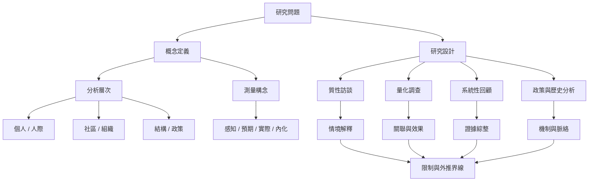

這張圖把理論定義、測量構念、研究設計與評估指標連在一起。研究者應清楚說明測量層次、時間尺度與推論範圍，避免把不同研究結果直接合併。

概念連結：[[實際污名經驗]]、[[感知污名]]、[[預期污名]]、[[內化污名]]、[[結構性污名]]、[[污名介入成效取決於情境而非單一萬用方案]]、[[結構性污名的操作化仍需跨研究建立可比較指標]]。

本圖屬於[[Social_stigma]]的閱讀與整理架構。
