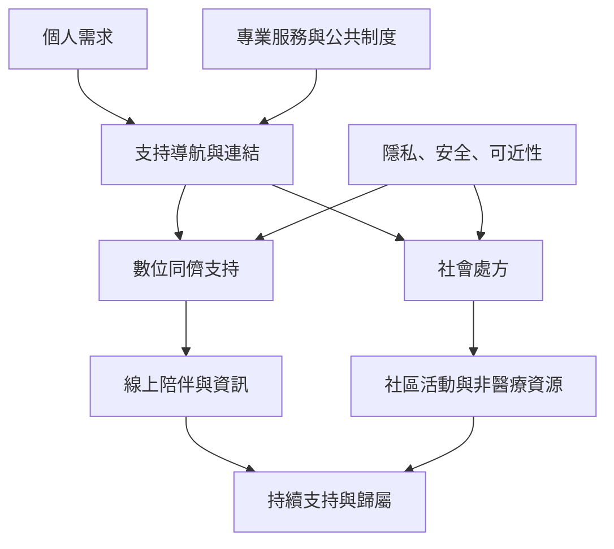

數位支持與社會處方都在嘗試擴大人們取得非正式與正式支持的路徑。數位平台能跨越地理限制，社會處方能把健康服務與社區資源連結；兩者都需要可近性、信任、隱私、安全與後續支持。技術或轉介本身不是關係，真正重要的是人是否能持續取得合適資源。

建議閱讀[[數位支持能擴大可及性但不能取代所有面對面關係]]、[[社會處方是醫療與社區資源之間的連結機制]]、[[社會處方能連結社區資源但現有孤獨研究證據仍有限]]。相關概念見[[同儕支持]]、[[社會處方]]、[[社會孤立]]與[[孤獨感]]。
