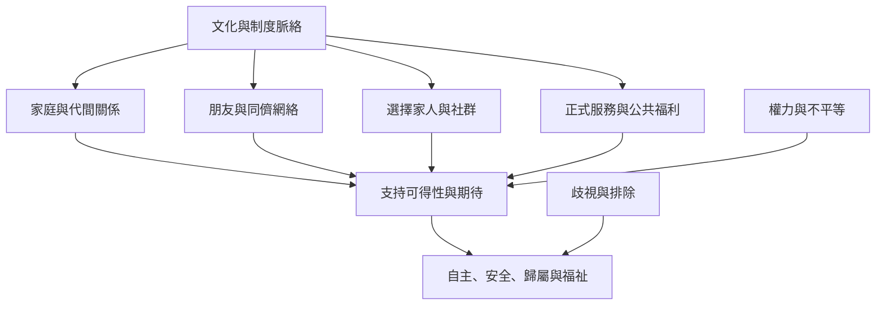

社會支持的來源與意義會受到家庭規範、代間關係、性別、族群、社會階級、移動經驗與制度環境影響。不能把某一地區或群體的支持形式當作普遍模板。跨文化研究應避免把「家庭支持」浪漫化，也要看見朋友、同儕、選擇家人與正式服務等多元網絡。

建議閱讀[[華人長者的家庭支持與家庭外支持會受到孝道脈絡調節]]、[[選擇家人可提供原生家庭以外的關係情感與物質支持]]、[[社會支持的測量必須符合研究問題與文化脈絡]]。相關概念見[[選擇家人]]、[[家庭支持]]（可延伸建立）、[[關懷倫理]]與[[社會凝聚]]。
