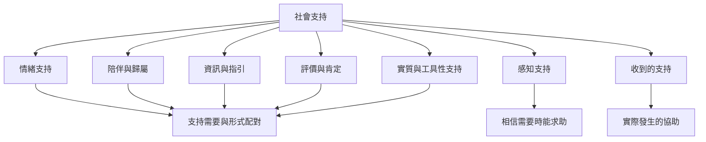

社會支持不是單一資源，而是由不同功能組成的支持組合。閱讀時可先辨識需求，再區分支持來源、支持功能與支持效果。最重要的檢查不是「提供者做了什麼」，而是「當事人需要什麼、是否同意、是否感到有幫助」。

建議閱讀[[社會支持是一組能回應不同需要的關係性資源]]、[[感知社會支持比收到多少幫助更能反映支持的可得性]]、[[支持需要與支持形式必須彼此配對]]、[[社會支持能透過直接效果與壓力緩衝兩種機制發揮作用]]。相關概念見[[社會支持]]、[[情緒支持]]、[[資訊支持]]、[[工具性支持]]、[[評價支持]]與[[感知社會支持]]。
