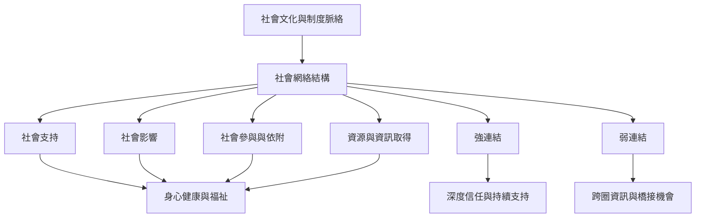

社會網絡是關係結構；社會支持是網絡可能提供的功能；社會整合是個人嵌入群體生活的程度。三者在不同層次影響身心健康、資源取得、社會參與及生活機會。分析時需要同時注意強連結與弱連結，以及關係網絡背後的制度和文化條件。

建議閱讀[[社會網絡社會整合與社會支持是彼此關聯但不同的概念]]、[[社會網絡透過支持影響行為參與與資源取得]]、[[強連結與弱連結提供不同而互補的支持]]。相關概念見[[社會網絡]]、[[社會整合]]、[[社會資本]]、[[社會凝聚]]與[[社會處境中的橋接連結]]。
