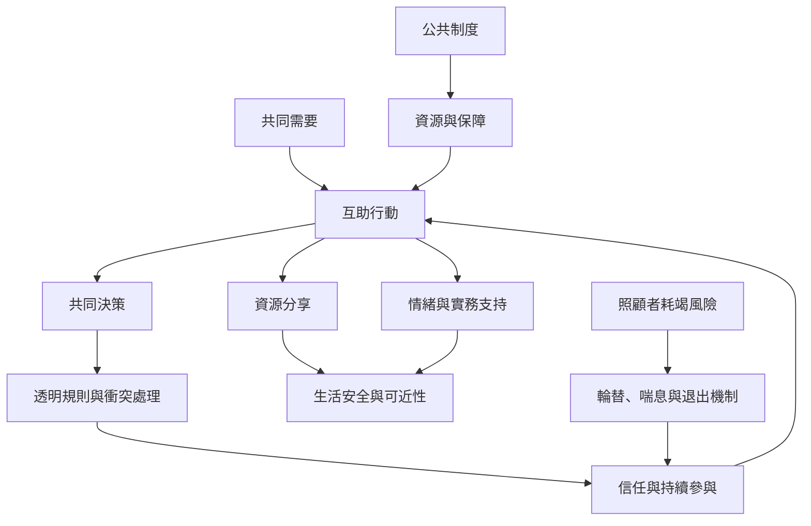

社群互助把支持從單向服務擴展成共同辨識需要、共享資源與協商規則的實踐。互助可以回應眼前危機，也能培養集體決策、信任與組織能力；但若沒有透明治理、照顧者支持與公平分工，也可能形成新的權力集中與耗竭。

建議閱讀[[互助不是單向慈善而是共同辨識需要並協同行動]]、[[互惠應容許非對等與延遲回報而不形成債務關係]]、[[社會支持需要同時在個人社群與制度層次建構]]。相關概念見[[互助]]、[[互惠]]、[[社區照護]]、[[關懷倫理]]與[[社會韌性]]。
