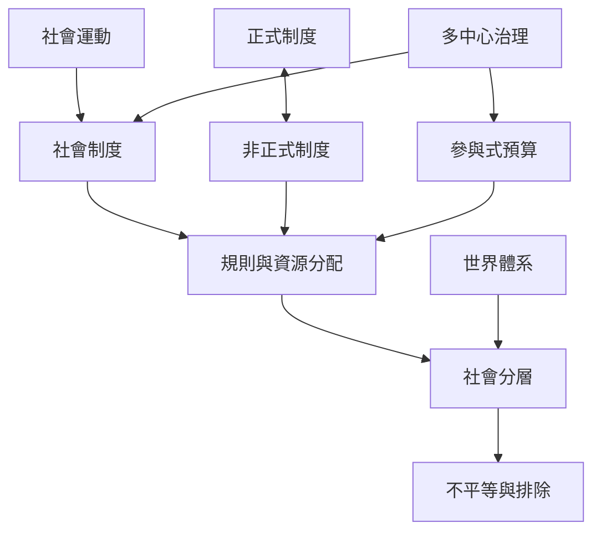

本圖將制度、權力與不平等放在一起理解。制度規範行動並分配資源；社會分層與全球體系塑造誰能取得資源；正式與非正式制度交錯運作；社會運動與參與式治理則可能改變規則與資源配置。

## 參考與連結
* [[社會制度]]、[[社會規範]]、[[社會分層]]、[[世界體系]]、[[多中心治理]]、[[社會運動]]、[[參與式預算]]、[[嵌入性]]。
* 核心筆記：[[制度改革必須同時檢視規則與資源分配]]、[[地方社會的可能性受到全球資源流動與權力位置制約]]、[[正式與非正式制度會彼此補位也會彼此衝突]]。
* 實踐延伸：[[用田野筆記比較正式規則與地方默契]]、[[追蹤一項日常商品背後的全球社會系統]]。
