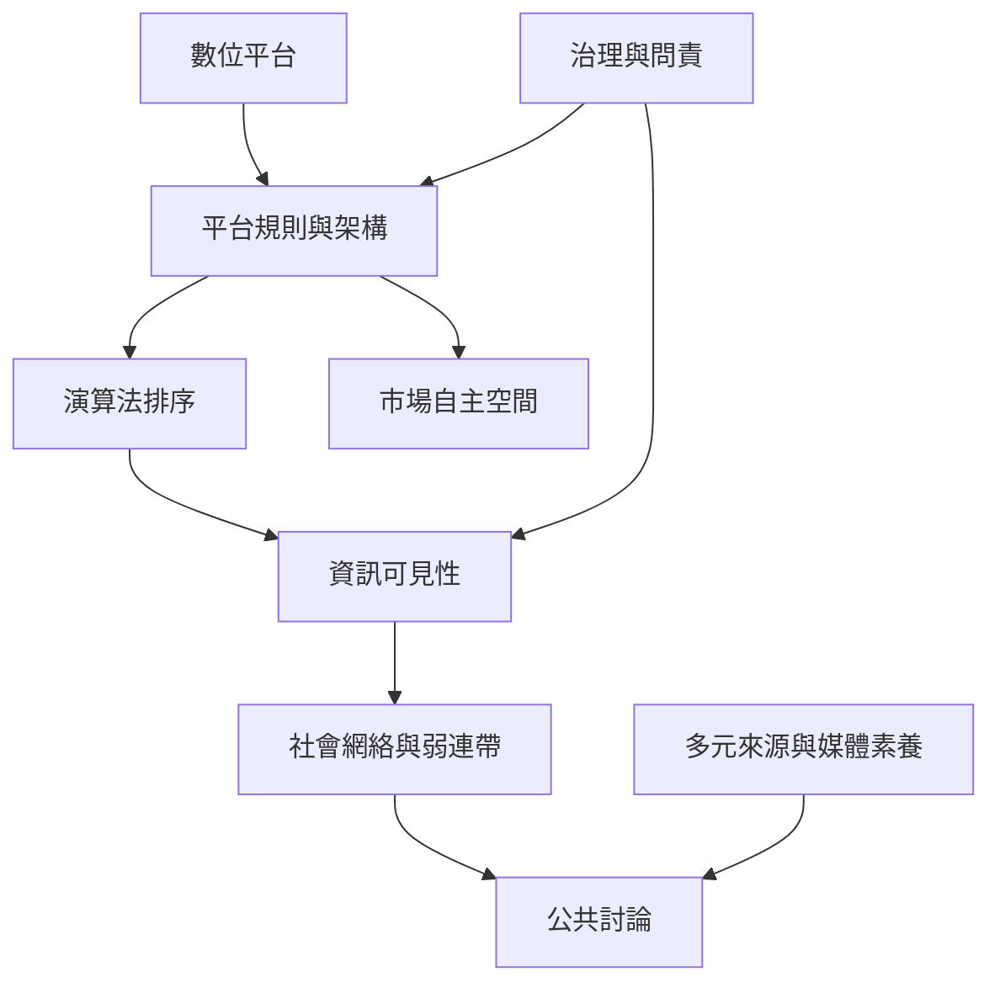

本圖把數位平台視為制度化的溝通環境。平台設計與演算法影響可見性、資訊異質性、參與門檻及市場自主；弱連帶可以跨越資訊群體，但推薦系統也可能強化封閉。治理因此需要透明規則、資料權利與公共問責。

## 參考與連結
* [[社會系統]]、[[溝通]]、[[社會網絡]]、[[弱連帶]]、[[社會制度]]、[[社會運動]]。
* 核心筆記：[[數位平台已成為日常社會治理的基礎設施]]、[[數位平台透過演算法安排資訊可見性與互動邊界]]、[[平台治理設計會影響市場參與者的自主空間]]。
* 實踐延伸：[[把演算法推薦當成一種社會田野來觀察]]。
