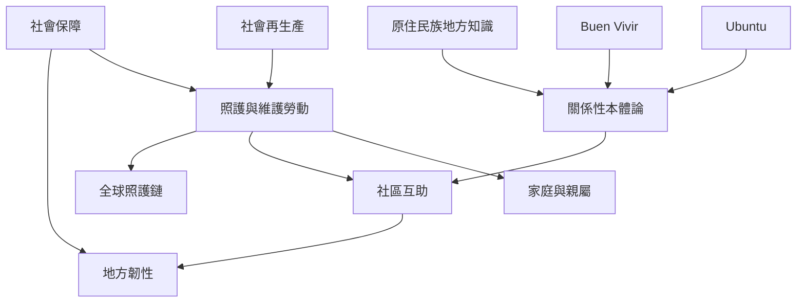

照護與社會再生產將家庭、社區、移動勞動與公共保障連結起來。Ubuntu、Buen Vivir 與原住民族知識提供關係性與地方性的分析資源，但必須尊重各自脈絡。地方互助與社會保障共同構成社會韌性的基礎。

## 參考與連結
* [[社會再生產]]、[[全球照護鏈]]、[[Ubuntu]]、[[Buen_Vivir]]、[[關係性本體論]]、[[韌性]]、[[社會生態技術系統]]。
* 核心筆記：[[照護工作是維持社會系統運作的隱形基礎]]、[[關係性觀點能補足以個人為中心的社會想像]]、[[社會韌性來自適應與轉型能力]]。
* 實踐延伸：[[為社區建立一份看得見維護工作的照護帳]]、[[以步行作為觀察地方社會系統的田野方法]]。
