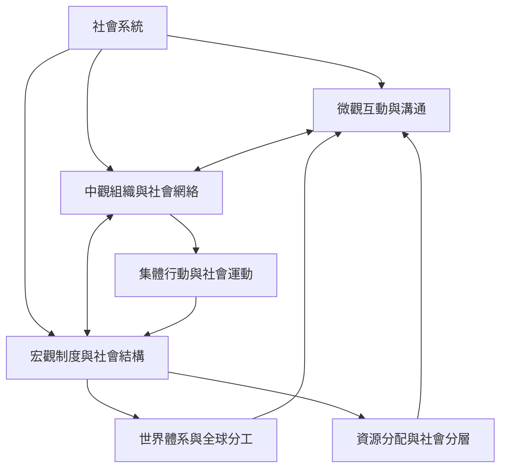

本圖把社會系統理解為多尺度、多層次的關係組合：互動與溝通形成日常秩序，組織與制度穩定期待，網絡分配資源，宏觀結構與全球體系則塑造行動條件。這不是單向因果圖，而是一個有回饋、衝突與轉型可能的分析框架。

## 參考與連結
* [[社會系統]]、[[社會結構]]、[[社會制度]]、[[社會網絡]]、[[溝通]]、[[自我再生產]]、[[功能分化]]、[[世界體系]]、[[社會分層]]。
* 核心筆記：[[社會系統不能只用個人總和來解釋]]、[[社會分析需要同時連結微觀中觀與宏觀層次]]、[[社會制度是被反覆實踐的共同期待]]。
* 實踐延伸：[[用一張關係地圖看見日常生活背後的互助系統]]。
