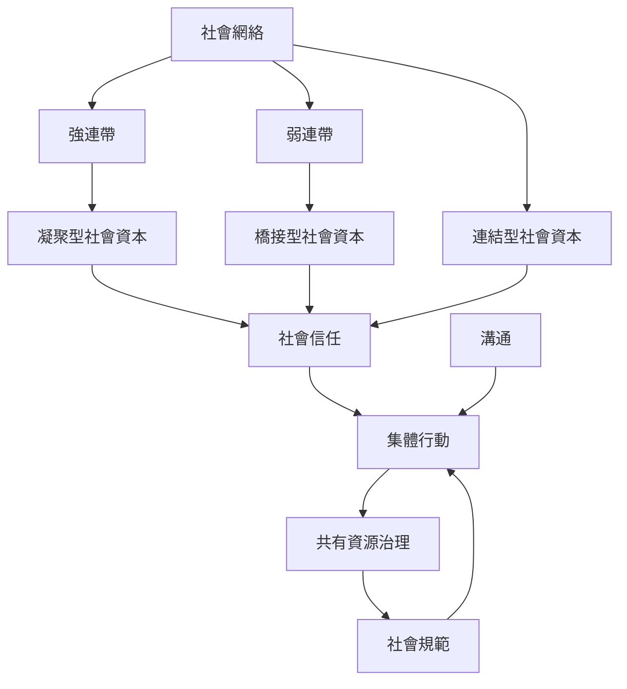

本圖聚焦關係如何支援合作，以及關係如何同時產生邊界。強連帶與凝聚型社會資本提供穩定支持；弱連帶與橋接型社會資本帶來跨群資訊；連結型社會資本則連接權力與制度。信任、溝通與共同規則共同影響集體行動。

## 參考與連結
* [[社會網絡]]、[[社會資本]]、[[凝聚型社會資本]]、[[橋接型社會資本]]、[[連結型社會資本]]、[[弱連帶]]、[[互惠]]、[[社會信任]]、[[集體行動]]、[[共有資源]]。
* 核心筆記：[[社會關係會透過網絡結構分配資訊與機會]]、[[社會資本同時創造支持與排除]]、[[公共資源需要共同制定的規則與持續監督]]。
* 實踐延伸：[[比較三種社會資本以找出社群的連結缺口]]、[[以讀書會建立跨圈層的弱連帶而非只累積熟人]]。
