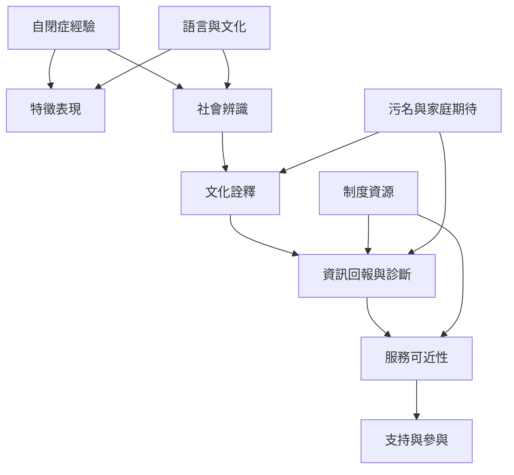

本地圖從特徵表現、社會辨識、文化詮釋、診斷回報到服務可近性，整理自閉症如何在不同地區被看見和支持。閱讀時請把文化視為動態脈絡，而不是國族性格。

## 核心永久筆記
* [[自閉症的辨識與診斷是文化和制度共同形塑的過程]]
* [[自閉症服務必須同時處理地理語言經濟與文化可近性]]
* [[全球自閉症辨識受到表現辨識詮釋與資源四層因素影響]]

## 文獻與案例
* [[世界衛生組織指出自閉症需求與能力具有多樣性]]
* [[台灣家長描述確診歷程包含不確定與逐步調適]]
* [[台灣與泰國比較研究指出融合教育仍面臨教師訓練與語言服務缺口]]
* [[南非早期介入研究強調費用語言地點與家庭參與]]
* [[拉丁裔照顧者辨識研究揭示語言與制度障礙]]

## 概念
[[自閉症]]、[[診斷落差]]、[[服務可近性]]、[[文化謙遜]]、[[交織性]]
