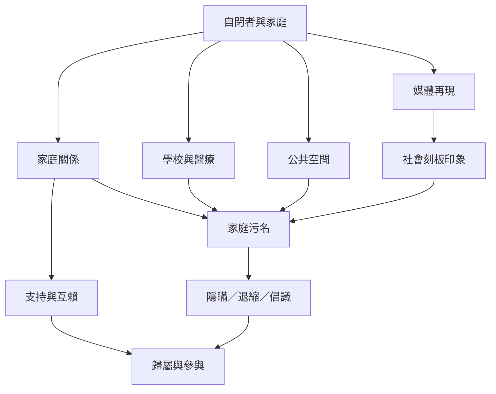

本地圖把家庭經驗放回學校、社區、公共空間、媒體和政策環境中理解，呈現支持與污名如何同時存在。

## 核心永久筆記
* [[家庭既可能提供支持也可能限制自閉者的自主決定]]
* [[家庭污名不是家庭個人的問題而是社會排除的結果]]
* [[自閉者的媒體再現會形塑社會對自閉症的想像]]

## 文獻與案例
* [[中國家長的污名經驗來自標籤與公共互動]]
* [[韓國邊界兒童案例呈現診斷標籤與學業常模的拉扯]]
* [[南非母親的確診經驗顯示傳統宗教與醫療途徑並存]]
* [[黎巴嫩研究顯示公共知識缺口與污名仍存在]]
* [[拉丁裔母親研究顯示家庭支持可能同時包含抵抗與陪伴]]

## 概念
[[污名]]、[[家庭污名]]、[[面子]]、[[ubuntu]]、[[交織性]]
