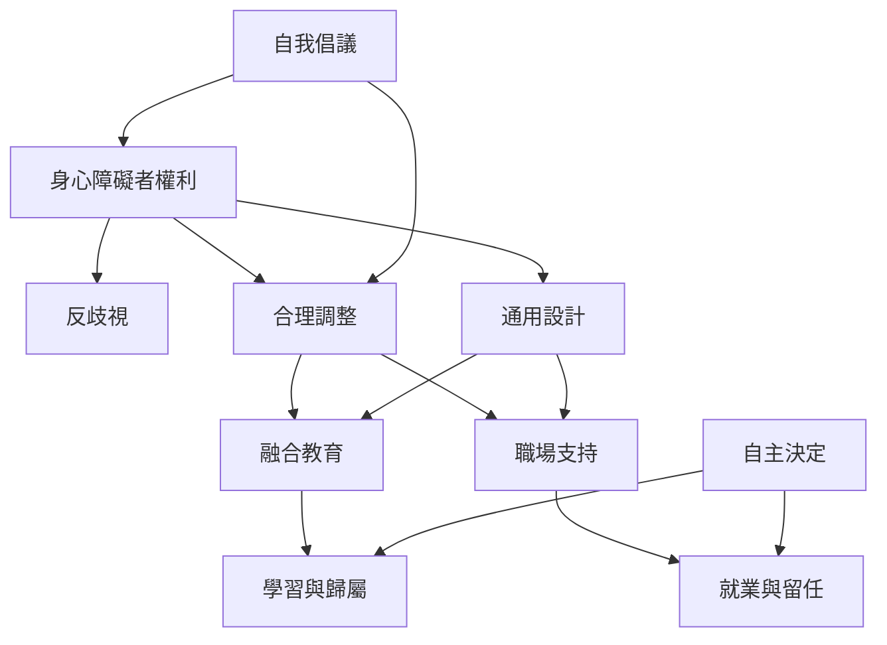

本地圖從障礙權利、合理調整與通用設計出發，連結教育、就業、社區生活和自主決定。評估重點不是形式上提供機會，而是能否平等參與。

## 核心永久筆記
* [[神經多樣性與障礙經驗可以同時被承認]]
* [[教育融合不能只把學生放進普通班而不提供支持]]
* [[職場能否接納自閉者取決於組織文化而不只個人能力]]

## 文獻與案例
* [[台灣與泰國比較研究指出融合教育仍面臨教師訓練與語言服務缺口]]
* [[身心障礙者權利公約把障礙理解為個人特徵與環境障礙的互動]]
* [[職場調整研究指出個別化環境與主管支持有助就業結果]]

## 概念
[[障礙的社會模式]]、[[合理調整]]、[[通用設計]]、[[融合教育]]、[[自主決定]]
