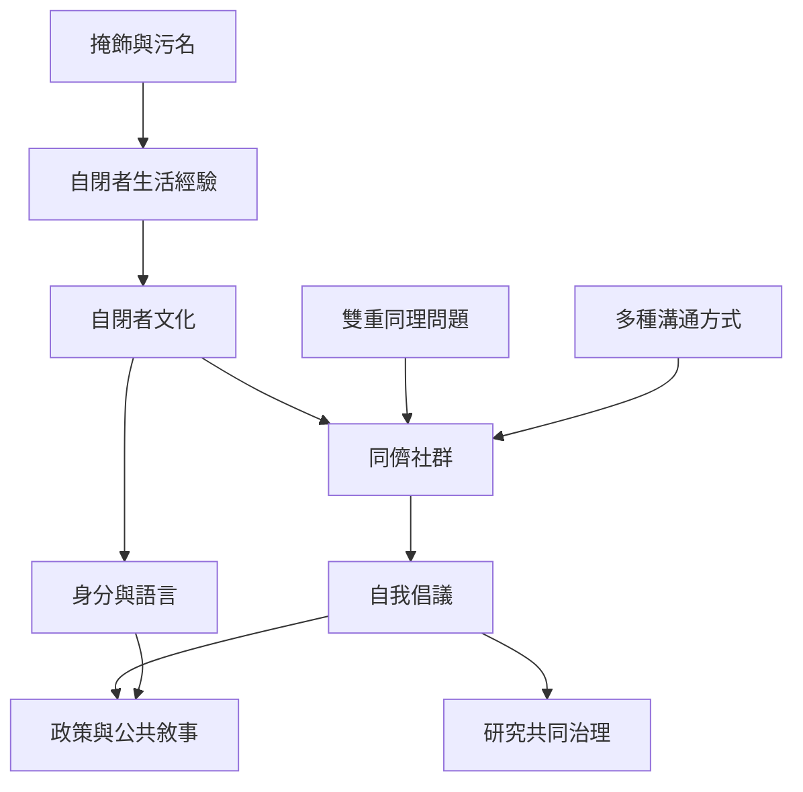

本地圖聚焦自閉者如何形成社群、理解身分、協商語言、進行自我倡議，並重構溝通與社會參與的定義。

## 核心永久筆記
* [[自閉者應參與所有影響自身生活的研究與政策決策]]
* [[自閉者的身分語言應尊重個人與社群的多元偏好]]
* [[自閉症的社會困難不能只歸因於個人的社交缺陷]]

## 文獻與案例
* [[日本自閉成人訪談呈現被誤解與渴望接納]]
* [[印度自閉成人把自主理解為自我決定與支持並存]]
* [[自閉者彼此之間的資訊傳遞可以有效進行]]
* [[自閉者自我倡議網絡主張沒有我們參與就不應替我們決定]]
* [[自閉者第一人稱文集呈現自閉社群如何形成自己的文化]]

## 概念
[[自閉者文化]]、[[自我倡議]]、[[雙重同理問題]]、[[身份優先語言]]、[[第一人稱敘事]]
