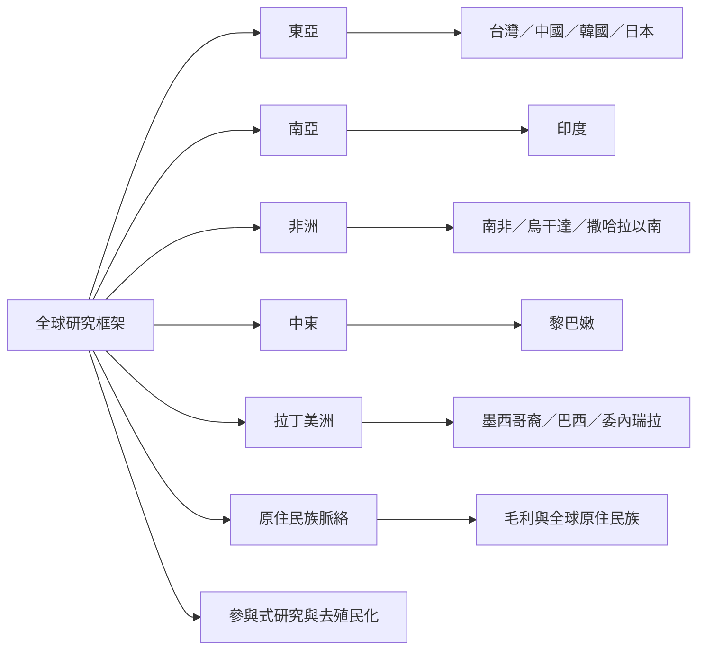

本地圖整理全球各地的研究材料、第一人稱敘事與知識缺口。地域範圍不是完整的全球代表樣本，而是用來辨識哪些問題已有證據、哪些仍需要當地自閉社群共同研究。

## 核心永久筆記
* [[跨文化自閉症研究需要從被研究者的問題開始]]
* [[自閉症文化研究應同時呈現自閉者與照顧者的不同聲音]]
* [[文化差異需要被理解但不能被寫成國民性格]]

## 文獻與案例
* [[全球自閉症辨識受到表現辨識詮釋與資源四層因素影響]]
* [[毛利自閉症研究指出需要符合原住民族世界觀的服務]]
* [[烏干達社區研究顯示超自然解釋與制度支持缺口並存]]
* [[拉丁裔照顧者辨識研究揭示語言與制度障礙]]
* [[巴西研究把自閉症成因信念與家庭社會環境放在一起討論]]
* [[委內瑞拉家長的診斷旅程反映醫療與教育系統的地域差異]]

## 概念
[[文化謙遜]]、[[參與式研究]]、[[去殖民化]]、[[交織性]]、[[質性研究]]
