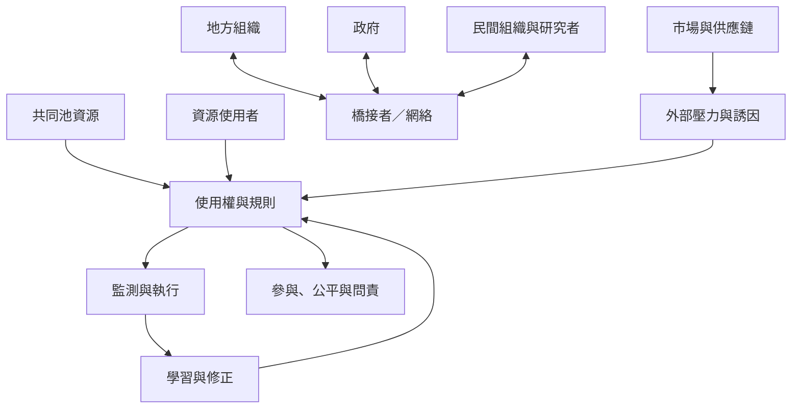

共同資源治理的焦點不是在國家與社區之間二選一，而是讓權利、責任、資訊、資源與問責落在適當的尺度。地方使用者需要能參與規則形成與監測；政府、研究者、民間組織及市場行動者則需處理地方無法單獨承擔的外部壓力。

閱讀[[地方自治需要跨尺度支持而非被孤立承擔責任]]，再以[[社區治理不等於社區內部權力平等]]檢查參與是否真正公平。地方規則如何取得正當性，見[[地方治理的正當性來自持續協商而非一次性同意]]。

此概念亦與[[斐濟海洋禁捕區的治理需處理社群內部的時間尺度衝突]]相連。

此概念亦與[[適應性治理依賴連結學習與制度多樣性]]相連。

## 概念連結
* [[共同池資源]]、[[公地]]、[[適應性治理]]、[[多中心治理]]、[[適應性共同管理]]。
* [[共同資源不等於無人管理的開放取用]]、[[參與必須包含影響決策的能力而不只是出席]]。
* [[把社區互助網絡視為地方韌性的基礎設施]]、[[用小規模制度實驗檢驗共享資源規則]]。

本書脈絡：[[Socio-ecological_system]]。
