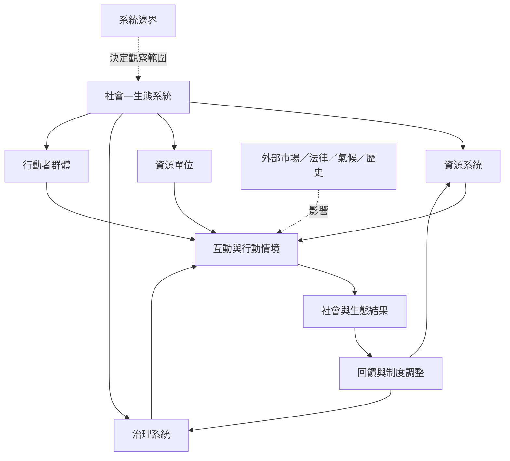

本圖整理 SES 的基本分析單位、系統邊界與因果回饋。閱讀時先確認分析的是哪個地方、資源與使用者，再追蹤治理規則如何影響互動及結果。框架提供共同語言，但需要用歷史、權力與跨域流動補足。

核心閱讀從[[社會—生態系統的核心構成可以用來診斷制度與資源互動]]開始，再讀[[系統邊界決定哪些互動會被看見]]與[[生態回饋會改變制度而制度也會改變生態]]。分析模型的來源見[[社會—生態系統需要共同框架才能累積跨學科知識]]。

## 概念連結
* [[社會—生態系統]]、[[共同池資源]]、[[公地]]、[[生態系服務]]。
* [[系統邊界決定哪些互動會被看見]]、[[多樣性與冗餘可降低系統對單一路徑的依賴]]。
* [[共同資源不等於無人管理的開放取用]]、[[把日常餐桌當成觀察社會—生態系統的微型實驗室]]。

本書脈絡：[[Socio-ecological_system]]。
