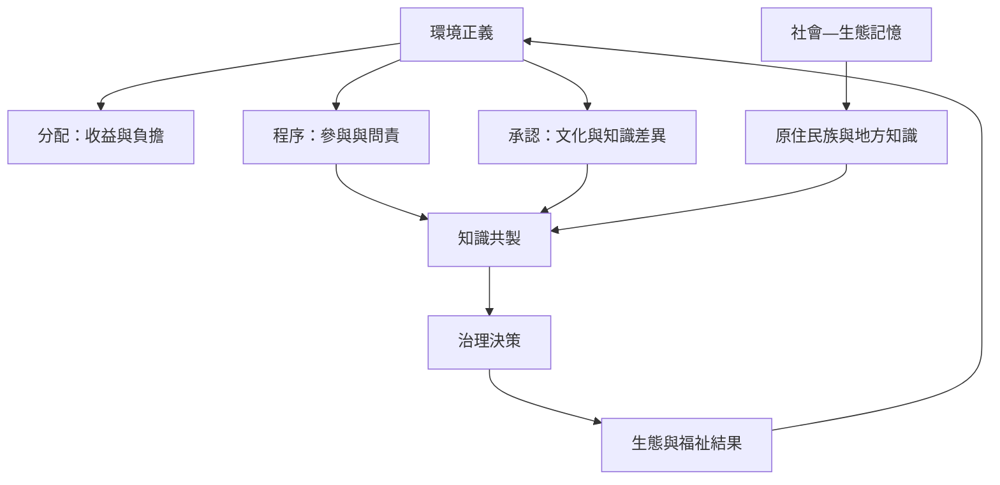

SES 分析若只看資源狀態和制度績效，容易忽略利益分配、歷史排除、知識權利與社群自主。本圖把環境正義、參與、知識共製與地方記憶連起來，提醒研究者：誰有權定義問題，會影響哪些知識被看見、哪些方案被認為可行。

閱讀[[韌性政策若忽略權力與公平可能固化不平等]]與[[韌性評估必須同時檢查收益與代價如何分配]]，再補上[[原住民族與地方知識能在多尺度自然治理中發揮作用]]及[[知識共製需要共享問題定義與資料權利]]。

此概念亦與[[納米比亞保育地收入與管理能力及外部支持呈正相關]]相連。

此概念亦與[[亞馬遜原住民領域有助維持流域生態連通性]]相連。

此概念亦與[[地方知識與制度記憶是連結社會與生態的關鍵]]相連。

此概念亦與[[尼泊爾社區林業雖促進賦權仍可能被地方菁英把持]]相連。

## 概念連結
* [[環境正義]]、[[原住民族與地方知識]]、[[社會—生態記憶]]。
* [[社區治理不等於社區內部權力平等]]、[[參與必須包含影響決策的能力而不只是出席]]。
* [[把照顧工作納入地方環境治理的成本計算]]、[[把地方知識整理成可共同維護的公共知識庫]]。

本書脈絡：[[Socio-ecological_system]]。
