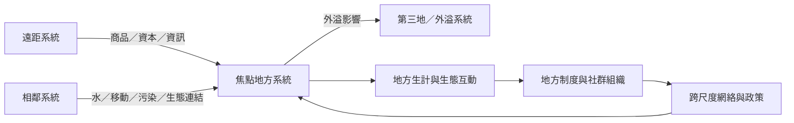

地方社會—生態系統不是封閉容器。商品、資本、資訊、人口、技術、物種與政策可以連接相鄰或遙遠的地方。案例比較的任務是辨識共同機制及其差異，而不是把成功案例的制度原樣複製到另一個地方。

先讀[[遠距人地互動使地方永續必須追蹤跨域流動]]，再比較斐濟、馬達加斯加、納米比亞、尼泊爾、亞馬遜與里山案例。跨地區比較應同時考量生態、制度、地方需求、外部支持與權力分配。

此概念亦與[[里山倡議以生產地景整合生物多樣性與地方福祉]]相連。

此概念亦與[[馬達加斯加案例顯示社群治理無法單獨抵擋外部市場壓力]]相連。

此概念亦與[[台灣社會—生態地景研究可放進全球里山案例比較]]相連。

此概念亦與[[斐濟海洋保護區的效果取決於監測執法與文化合宜性]]相連。

此概念亦與[[跨地區社區保育案例顯示治理成效取決於在地需求與外部支持]]相連。

此概念亦與[[人類世的永續轉型必須治理交織與跨尺度風險]]相連。

## 概念連結
* [[跨耦合]]、[[社會—生態生產地景與海景]]、[[生態系服務]]。
* [[全球供應鏈會把地方生態成本轉移到遠方]]、[[生產地景可以同時是生計空間與保育空間]]。
* [[為一項日常商品繪製跨地域人地關係圖]]、[[以步行建立一份社區社會—生態觀察日誌]]。

本書脈絡：[[Socio-ecological_system]]。
