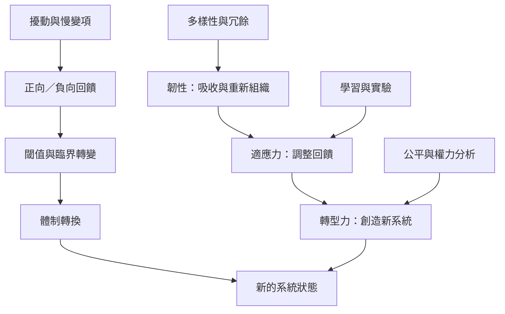

本圖呈現社會—生態系統的動態：壓力透過回饋累積，可能跨越閾值而造成體制轉換。治理者可以透過多樣性、學習與監測增強應對能力，但若現有系統狀態本身不公平或不可持續，就需要考慮轉型，而不是只強化原有安排。

先讀[[韌性不是維持現狀的同義詞]]，再對照[[社會—生態系統研究應把轉型與制度重組放進分析]]。韌性的動態基礎見[[韌性視角將生態變化理解為非線性且跨尺度的動態]]，而政治批判見[[韌性政策若忽略權力與公平可能固化不平等]]。

此概念亦與[[社會—生態陷阱的形成必須納入權力分析]]相連。

此概念亦與[[社會—生態韌性可由七項原則共同培養]]相連。

## 概念連結
* [[社會—生態韌性]]、[[體制轉換]]、[[閾值]]、[[泛層級循環]]、[[社會—生態陷阱]]。
* [[多樣性與冗餘可降低系統對單一路徑的依賴]]、[[轉型能力是在不良系統狀態中創造新路徑]]。
* [[把日常餐桌當成觀察社會—生態系統的微型實驗室]]、[[設計一張能同時呈現生態與公平的地方韌性儀表板]]。

本書脈絡：[[Socio-ecological_system]]。
