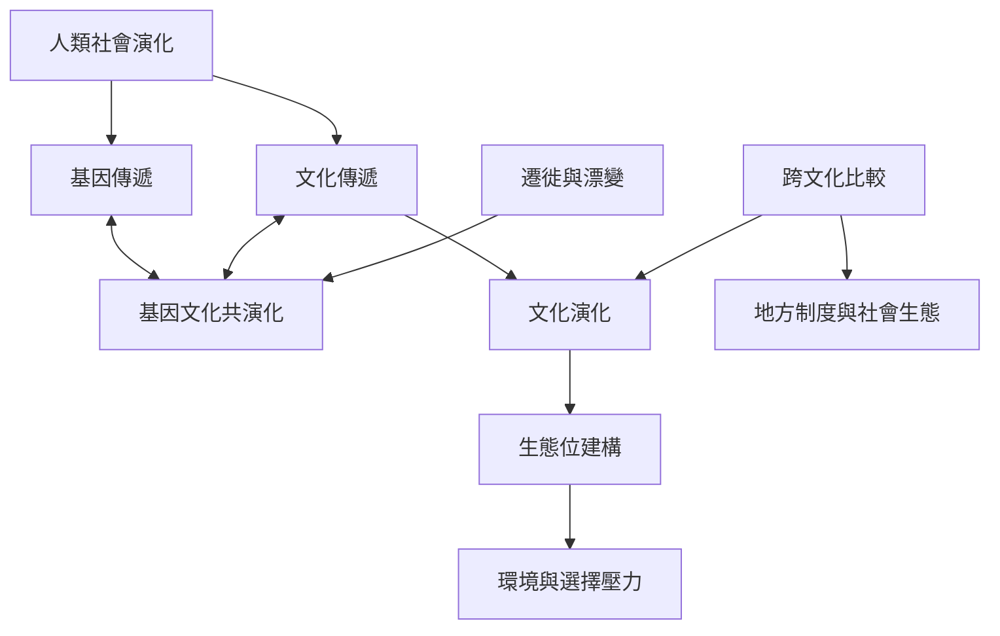

人類社會行為不是基因與文化二選一的結果。文化傳遞、制度與技術會改變環境和人口互動，基因變異、漂變與遷徙也會影響文化實踐的分布。這張地圖呈現基因—文化共演化、生態位建構、文化演化與跨文化研究的關聯。

## 相關概念
* [[基因文化共演化 Gene-culture coevolution]]、[[文化演化 Cultural evolution]]、[[生態位建構 Niche construction]]
* [[自然選擇 Natural selection]]、[[跨文化比較 Cross-cultural comparison]]、[[遺傳率 Heritability]]
* [[文化是演化系統中的傳承機制和環境建構者]]、[[集體知識的累積使文化成為人類適應能力的核心]]

## 延伸閱讀
* [[歐布萊恩與班特利說明基因文化與生態位共同塑造人類演化]]
* [[卡瑟等人提出應把漂變與遷徙納入廣義基因文化共演化]]
* [[亨里奇認為文化累積是人類適應能力的重要基礎]]
* [[亨里奇等人的跨文化實驗顯示社會規範塑造經濟行為]]

## 相關地圖
* [[社會生物學的核心問題與學科邊界]]
* [[解釋合作與利他的演化機制]]
* [[社會生物學的歷史爭論與批判方法]]
